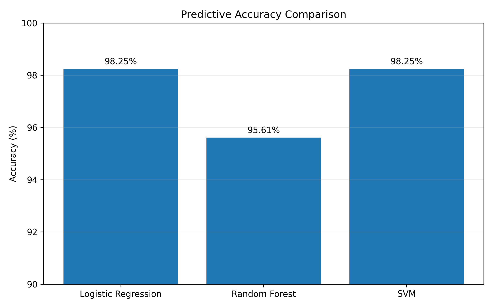
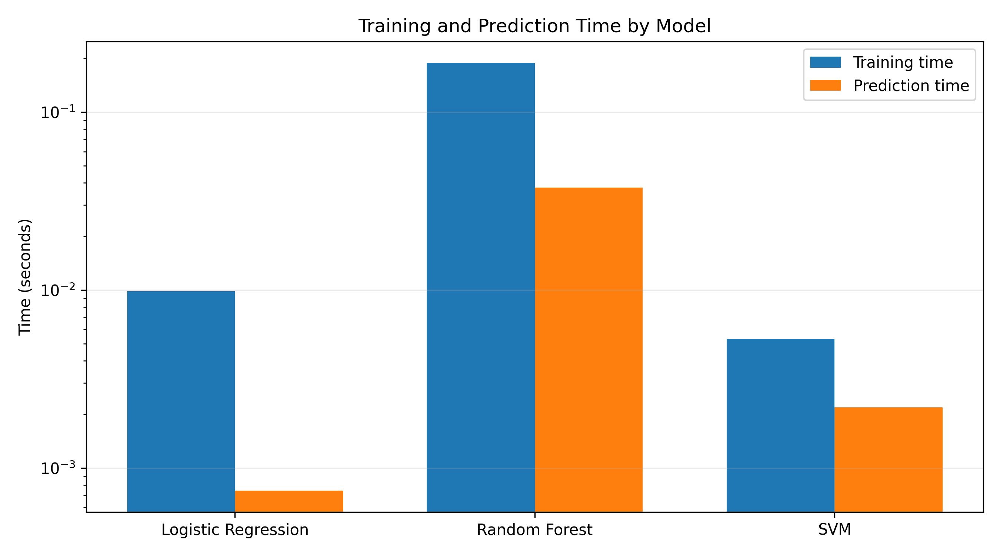
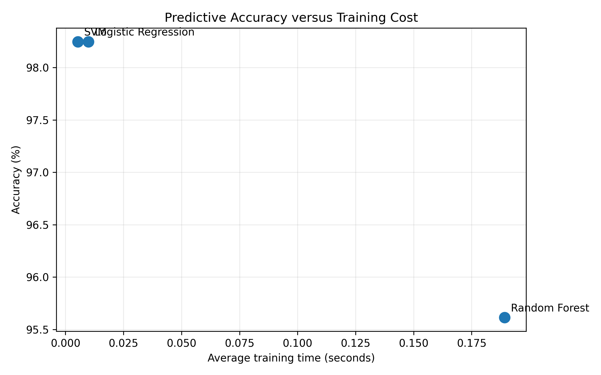
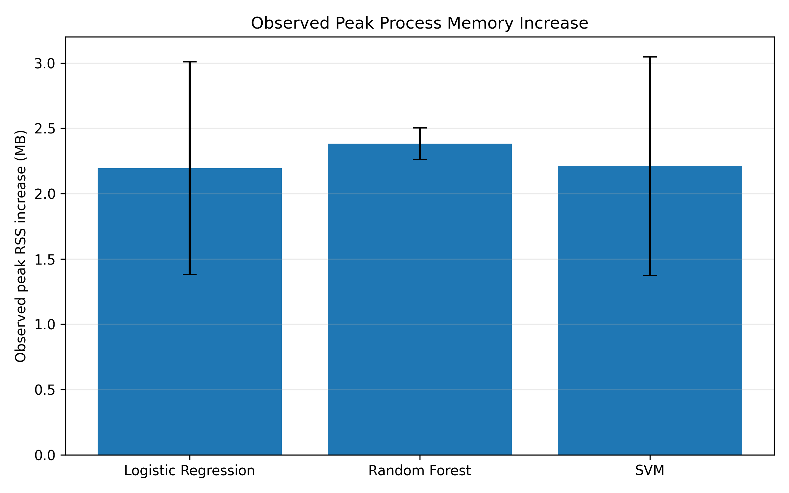
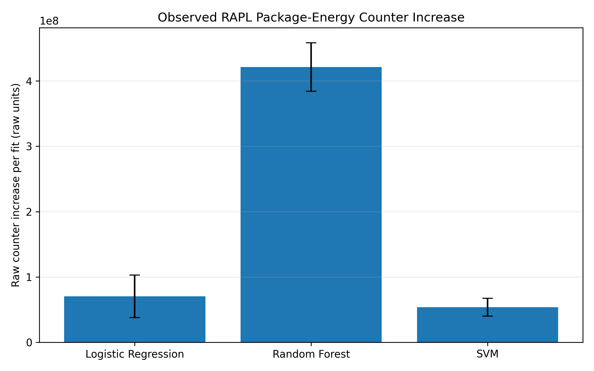

# 🌱 Green AI Benchmarking Framework

**An experimental comparison of machine learning accuracy, execution time, process memory usage, and energy-related measurements.**

This project investigates the computational trade-offs of three classification algorithms using a consistent dataset and train-test split. It combines predictive performance with resource-related measurements to explore more resource-aware machine learning.

## 🎯 Research Objectives

- Compare Logistic Regression, Random Forest, and Support Vector Machine (SVM).
- Evaluate predictive accuracy, training time, and prediction time.
- Measure observed peak process memory usage.
- Collect raw CPU package energy-counter deltas where supported.
- Analyse trade-offs between predictive performance and computational cost.
- Automate result aggregation and visualization using Python.

##  Models Evaluated

| Model | Configuration |
|---|---|
| Logistic Regression | StandardScaler pipeline; `max_iter=5000` |
| Random Forest | 100 trees; `n_jobs=-1` |
| Support Vector Machine | StandardScaler pipeline |

## 📊 Dataset and Experimental Setup

The experiments use the Breast Cancer Wisconsin Diagnostic dataset available through scikit-learn.

| Property | Description |
|---|---|
| Samples | 569 |
| Input features | 30 |
| Task | Binary classification |
| Train-test split | 80:20 |
| Stratification | Yes |
| Random state | 42 |

The fixed split supports a controlled comparison between the selected models. Accuracy results may change with a different split or dataset.

##  Key Results

### Predictive performance

| Model | Accuracy |
|---|---:|
| Logistic Regression | 98.25% |
| Random Forest | 95.61% |
| SVM | 98.25% |

Logistic Regression and SVM achieved the same accuracy on the evaluated test split. Random Forest achieved approximately 2.63 percentage points lower accuracy.

### Average execution time

| Model | Training time (s) | Prediction time (s) |
|---|---:|---:|
| Logistic Regression | 0.009831 | 0.000745 |
| Random Forest | 0.189237 | 0.037707 |
| SVM | 0.005318 | 0.002186 |

These values are averages from repeated timing benchmarks. Timing can vary with system load, software versions, and hardware conditions.

### Observed peak process memory

| Model | Average peak RSS (MB) | Average peak RSS increase (MB) |
|---|---:|---:|
| Logistic Regression | 154.625 | 2.195 |
| Random Forest | 154.780 | 2.383 |
| SVM | 154.408 | 2.211 |

RSS means resident set size: the physical memory occupied by the measured process. These measurements include Python, loaded libraries, data, model objects, and temporary allocations; they are not exact model-only memory measurements.

### Raw energy-counter measurements

| Model | Average raw counter delta per fit |
|---|---:|
| Logistic Regression | 70,278,910 |
| Random Forest | 421,312,400 |
| SVM | 53,750,760 |

**Important:** These are raw RAPL package energy-counter deltas, not verified joules. They have not been calibrated or validated as physical energy measurements. Package-level readings can include operating-system and background activity, so they should be interpreted as exploratory energy-related indicators rather than definitive energy consumption.

## 📈 Visualizations

### Accuracy comparison



### Training and prediction time



### Accuracy versus training time



### Peak process memory



### Raw RAPL counter comparison



## 🔬 Interpretation

The results illustrate that model selection involves multiple computational trade-offs.

- **Logistic Regression** matched SVM's test accuracy and had the lowest average prediction time in these experiments.
- **SVM** achieved the fastest average training time and the lowest observed average raw RAPL counter delta.
- **Random Forest** had the lowest test accuracy of the three models, the longest measured training and prediction times, and the highest average peak RSS increase and raw counter delta.

These observations apply only to the tested dataset, configurations, software environment, and machine. They do not establish a universal ranking of these algorithms.

## 🛠️ Technology Stack

- Python
- NumPy
- Pandas
- scikit-learn
- Matplotlib
- psutil
- Windows and available RAPL energy-counter interfaces

## ⚙️ Installation

Clone the repository:

```bash
git clone https://github.com/Shyrestha/green-ai-benchmarking.git
cd green-ai-benchmarking
```

Create and activate a virtual environment in PowerShell:

```powershell
python -m venv .venv
.\.venv\Scripts\Activate.ps1
```

Install the recorded dependencies:

```bash
python -m pip install -r requirements.txt
```

##  Run the Workflow

### Analyse existing measurements

```bash
python run_green_ai.py
```

Safe mode combines the existing benchmark summaries, updates the trade-off analysis, and regenerates the research plots.

### Rerun the experiments

```bash
python run_green_ai.py --full
```

Full mode reruns timing, memory, and raw energy-counter experiments before rebuilding the analysis and visualizations. It can overwrite existing benchmark CSV files, so back up any results you want to preserve first.

## 📁 Repository Structure

```text
green-ai-benchmarking/
├── run_green_ai.py
├── repeated_benchmark.py
├── peak_memory_benchmark.py
├── energy_benchmark.py
├── combine_results.py
├── green_ai_analysis.py
├── plot_green_ai_research.py
├── requirements.txt
├── README.md
└── results/
    ├── metrics/
    └── plots/
```

Other baseline, diagnostic, and visualization scripts are included in the repository.

## ⚠️ Methodology and Limitations

- Accuracy is currently evaluated using one fixed stratified train-test split.
- Timing results are experimental measurements and can vary between runs.
- Peak RSS is sampled and may miss brief memory peaks.
- Memory measurements represent the complete measured process rather than model-only memory.
- RAPL results are raw counter deltas and have not been verified as joules.
- Timing, memory, and energy-counter measurements were collected in separate experiments; they are not synchronized observations of a single execution.
- Results should not be generalized to other hardware, datasets, or model configurations without further experiments.

##  Future Work

- Repeat accuracy evaluation across multiple stratified splits or cross-validation folds.
- Report confidence intervals and additional statistical comparisons.
- Improve isolation of benchmark processes and quantify background-system effects.
- Validate energy-counter units and measurement methodology.
- Evaluate additional datasets and model families.
- Investigate accuracy-resource trade-offs across a broader range of workloads.

##  Motivation: Green AI

Green AI encourages consideration of computational resources alongside predictive performance. This project is an initial experimental framework for exploring those trade-offs through reproducible measurements, transparent reporting, and careful interpretation.

##  Author

Developed as a Python-based machine learning benchmarking and Green AI exploration project.

**Repository:** [github.com/Shyrestha/green-ai-benchmarking](https://github.com/Shyrestha/green-ai-benchmarking)
